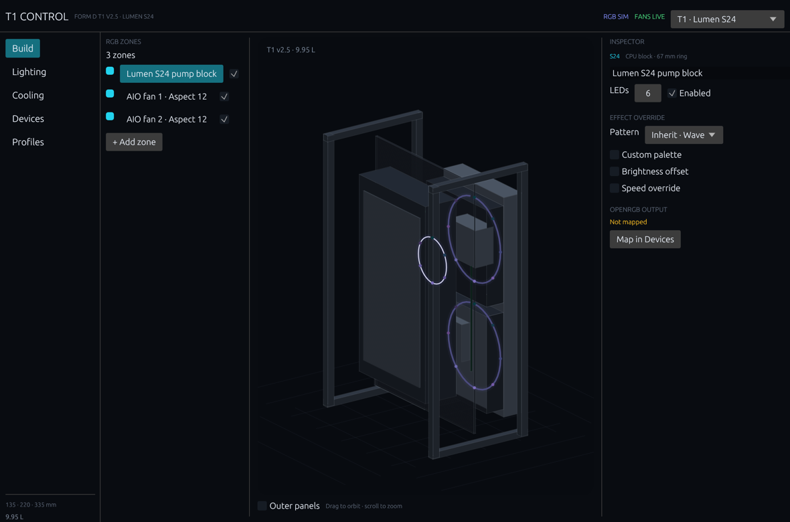
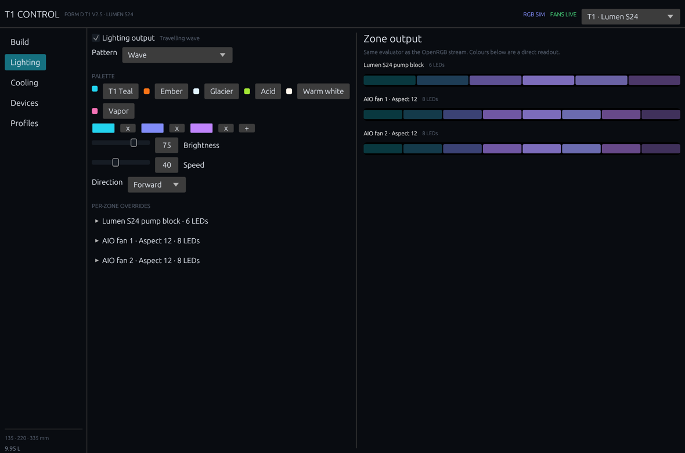
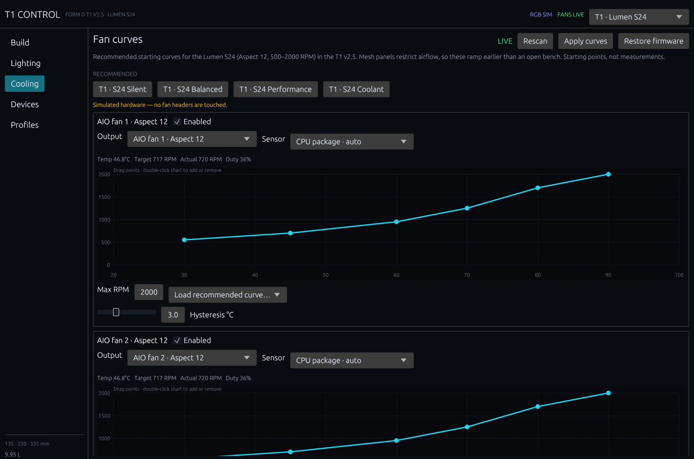
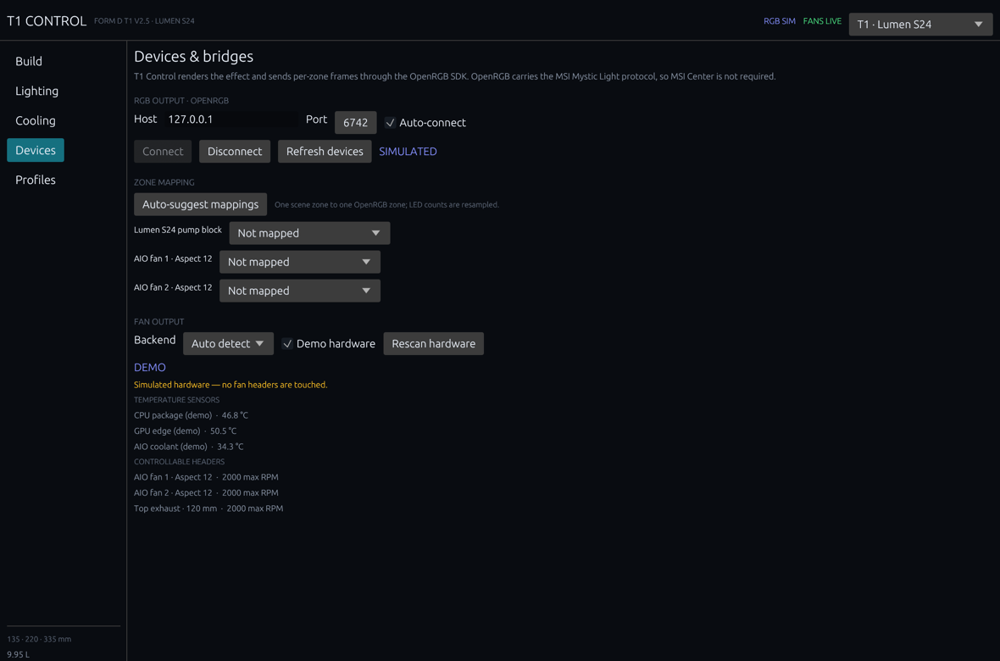
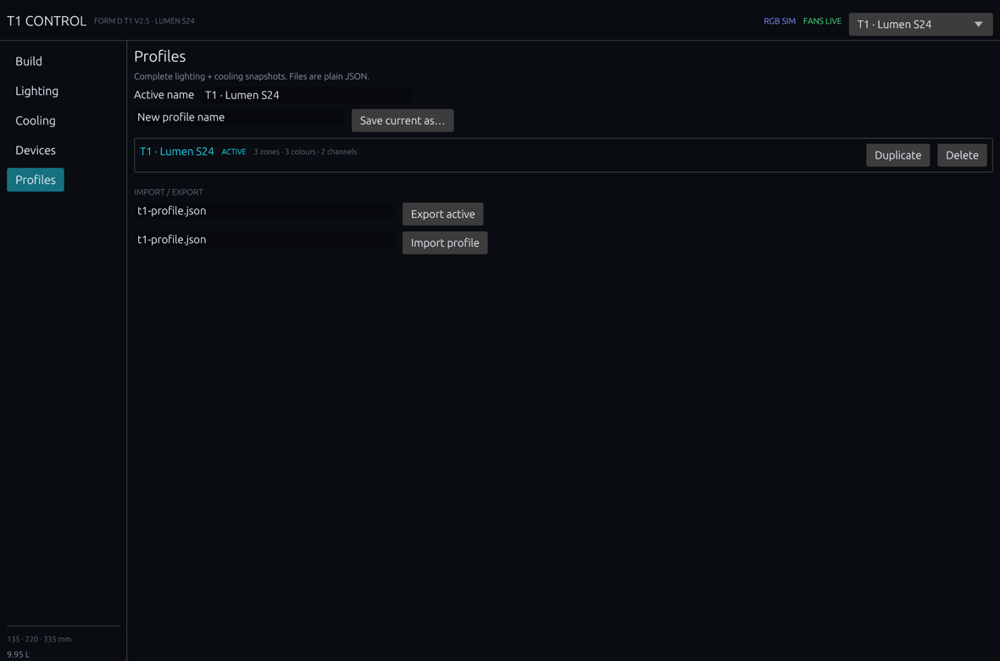
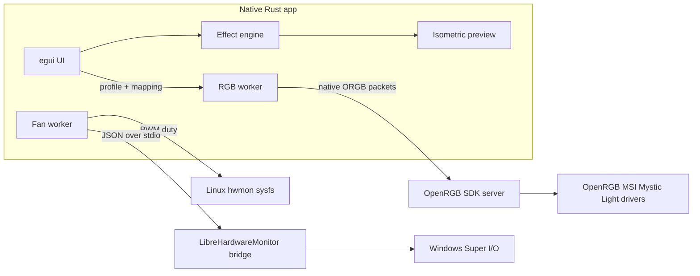

# T1 Control

Case-specific RGB and fan control for the **NCASE / FormD T1 v2.5** with a **Fractal Design Lumen S24** AIO.

T1 Control is a small native Rust application. It uses `egui`/`eframe` for the UI, a native OpenRGB SDK client, and native fan backends. There is no Electron, Chromium, Node.js, or React in the app. The release binary is about **4.4 MB** on macOS; the Windows build is a single portable `.exe`.



## Core functionality first

- **Fan curves** — sensor-driven piecewise curves with hysteresis, slew limiting, min/max RPM, explicit channel mapping, and a fail-safe if a sensor disappears. Recommended Lumen S24 curves are included.
- **RGB effects** — static, gradient, breathing, colour cycle, rainbow, wave, meteor, and temperature-reactive patterns; palettes, brightness, speed, direction, and per-zone overrides.
- **Native OpenRGB client** — a native Rust implementation of the OpenRGB SDK protocol (controller enumeration, custom mode, per-zone LED frames). OpenRGB carries the low-level MSI Mystic Light protocol, so MSI Center is not required.
- **Zone mapping** — one scene zone to one OpenRGB zone, with automatic LED-count resampling. Auto-suggest only proposes; the mapping table is authoritative.
- **Profiles** — complete lighting + cooling snapshots as plain JSON, with import and export.
- **Demo hardware** — simulated sensors and fan outputs for UI work, screenshots, and checking a profile before it touches hardware. Demo mode never writes PWM and never sends RGB frames.

The **3D preview is deliberately secondary**: a lightweight software isometric renderer draws the T1, Lumen block, fans, radiator, GPU, and PSU and updates the RGB rings/strips from the same effect frames. It has no GPU-heavy animation and can be replaced later with a richer renderer without touching the core.

| Lighting | Cooling |
| --- | --- |
|  |  |

| Devices & mapping | Profiles |
| --- | --- |
|  |  |

All screenshots are captured by the app itself in **demo mode** (`--demo`) from a 1180 × 780 window. eframe captures the retina framebuffer, so the committed images were downscaled from 2360 × 1560 to 1180 × 780.

## Hardware support

| Capability | Linux | Windows | macOS |
| --- | --- | --- | --- |
| UI, effects, profiles | ✅ | ✅ | ✅ |
| RGB output | ✅ via OpenRGB SDK | ✅ via OpenRGB SDK | ✅ via OpenRGB SDK (device support depends on OpenRGB) |
| Fan curves | ✅ `/sys/class/hwmon` | ✅ LibreHardwareMonitor bridge | ⛔ not applicable |
| Restore firmware control | ✅ | ✅ | — |

- **Linux** reads and writes `pwmN`, `pwmN_enable`, `fanN_input`, and `tempN_input` under `/sys/class/hwmon`. Only writable PWM channels are listed. Original enable modes and duties are restored on disable and exit.
- **Windows** uses the bundled PowerShell bridge around **LibreHardwareMonitorLib**. Set the DLL path in Devices, run T1 Control elevated, and map a fan channel. LHM is the maintained user-mode path to Super I/O fan headers on Windows.
- **macOS** does not expose desktop fan headers, so T1 Control is a preview/RGB host there. The backend reports this instead of pretending.
- **Fan control is a foreground app.** It writes only after you map a channel and press Apply. Closing the app restores firmware control. No service, driver, or boot task is installed.

The Linux and Windows fan backends were implemented against their public APIs but were not exercised against a physical MSI motherboard in this repository. They return specific errors when hardware, permissions, or mappings are missing.

## Build and run

Requirements: Rust **1.88+** (stable).

```bash
cargo run --release
cargo run --release -- --demo          # simulated hardware, temp config
cargo test --lib --no-default-features # core tests, no GUI dependencies
cargo build --release                  # target/release/t1-control
```

Useful CLI options:

```text
--demo                  simulated RGB + fan hardware; uses a temp config
--config PATH           use a specific config file
--page NAME             build | lighting | cooling | devices | profiles
--screenshot PATH       capture the window to PNG, then exit
```

The app writes its config to the platform config directory (for example `~/Library/Application Support/dev.ricaud.T1 Control/config.json` on macOS).

The screenshot path uses eframe's own framebuffer capture, so no screen-recording permission is needed:

```bash
target/release/t1-control --demo --config /tmp/t1-demo/config.json \
  --page build --screenshot /tmp/t1-build.png
# macOS: downscale the retina capture for the README
sips -z 780 1180 /tmp/t1-build.png --out docs/screenshots/build.png
```

### First run

1. Open **Devices**.
2. Start the [OpenRGB](https://openrgb.org/) server with its SDK server enabled (default `127.0.0.1:6742`), then press **Connect**.
3. In **Zone mapping**, press **Auto-suggest mappings**, then review every row. LED counts are resampled automatically.
4. For fan control, choose a backend, rescan, and map each AIO fan channel to a hardware PWM output.
5. Open **Cooling**, choose a recommended curve (Balanced is the default), then press **Apply curves**.

### Linux permissions

Writing PWM is privileged. Prefer a udev rule scoped to the hwmon attributes over running the whole app as root:

```udev
# /etc/udev/rules.d/99-t1-control.rules
SUBSYSTEM=="hwmon", ACTION=="add", RUN+="/bin/chgrp -R t1control /sys/class/hwmon/%k", RUN+="/bin/chmod -R g+w /sys/class/hwmon/%k"
```

Add your user to `t1control`, reload udev, and reboot or re-trigger the device. Scope the rule to the Super I/O device you actually use if the machine has several. Verify with `udevadm info -a -p /sys/class/hwmon/hwmonX` and `ls -l /sys/class/hwmon/hwmonX/pwm*`.

### Windows fan control

1. Download [LibreHardwareMonitor](https://github.com/LibreHardwareMonitor/LibreHardwareMonitor/releases) and locate `LibreHardwareMonitorLib.dll` (use the .NET Framework build for Windows PowerShell 5.1). Keep its companion DLLs in the same folder.
2. In **Devices → Fan output**, enter the DLL path.
3. Launch T1 Control as administrator.
4. Press **Rescan hardware**, map the AIO fan headers in **Cooling**, then **Apply curves**.

The bridge follows LHM's public `IControl` API (`SetSoftware`, `SetDefault`) and speaks newline-delimited JSON. CI parses the PowerShell bridge for syntax errors before packaging.

## Recommended Lumen S24 curves

The two Aspect 12 PWM fans on the Lumen S24 are rated **500–2000 RPM**. The T1's mesh panels restrict airflow, so these curves ramp earlier than an open-bench curve. They are starting points, not lab measurements:

| Preset | Points (°C → RPM) | Notes |
| --- | --- | --- |
| Silent | 35→500, 50→600, 65→800, 75→1100, 85→1600, 95→2000 | Late ramp; listen for turbulence above ~1100 RPM |
| **Balanced** | 30→550, 45→700, 60→950, 70→1250, 80→1700, 90→2000 | Recommended default for the S24 in the T1 |
| Performance | 30→700, 45→950, 55→1300, 65→1700, 75→2000 | For sustained CPU loads |
| Coolant | 30→500, 35→700, 40→1100, 45→2000 | Only if your AIO exposes a coolant sensor |

Defaults: CPU package sensor, 3 °C hysteresis, 400 RPM/s ramp up, 150 RPM/s ramp down. The Lumen S24 pump is **not** PWM-controlled; the app controls the radiator fans (or any additional mapped headers).

## Architecture



The library (`src/lib.rs`) contains the testable core without GUI dependencies:

- `model`, `config`, `presets` — types, defaults, validation, profiles
- `effects` — the shared effect evaluator
- `fan` — curve interpolation, hysteresis, slew limiting, sensor resolution
- `openrgb` — native SDK client and protocol parser
- `rgb_service`, `fan_service`, `fan_backend` — background workers and hardware backends

The GUI feature (`gui`, enabled by default) adds `app` and `preview`. Core tests run with `--no-default-features`, so CI does not need a display or GUI libraries.

## GitLab CI

`.gitlab-ci.yml` defines:

- **test** on `rust:1-bookworm`: `cargo test --lib --no-default-features` and a core `cargo check`.
- **package:windows** on `saas-windows-medium-amd64`: installs a pinned stable Rust via rustup if needed, runs the core tests, builds the release GUI, checks the PowerShell bridge syntax, and packages the executable.

Artifact:

```
dist/t1-control-windows-x64.zip
  t1-control-windows-x64.exe
  README.md
  LICENSE
```

The zip is available from the pipeline **Artifacts** panel and the job page for 30 days. It is unsigned, so Windows SmartScreen may warn on first launch.

> **Repository note:** this checkout's `origin` is `git@github.com:ricaud/t1-controll.git`. GitLab CI only runs when the project is hosted on GitLab. Push or mirror the repository to GitLab (or change the remote) for the pipeline to produce the Windows artifact.

## Validation

- `cargo test --lib --no-default-features` — 19 tests: curve interpolation, hysteresis, slew limits, fail-safe math, effect bounds/determinism, palette sampling, config validation/save/import, zone presets, and OpenRGB payload/parser tests plus a full mock OpenRGB server session.
- `cargo check` — GUI build compiles.
- `cargo build --release` — native binary, about 4.4 MB on macOS.
- Native screenshots for all five pages are captured by the app itself via `--screenshot`.
- Hardware validation against a physical MSI board, Linux PWM headers, and Windows Super I/O is intentionally left to the machine that owns the T1. The app reports actionable errors instead of fabricating success.

## Known limitations

- **OpenRGB is the RGB transport/runtime dependency.** The effect engine, mapping, and protocol client are native, but the low-level MSI Mystic Light driver lives in OpenRGB. Direct SMBus/HID drivers are board-specific and were not shipped without hardware captures.
- **The 3D preview is a lightweight isometric renderer**, not a fitment-certified CAD assembly. Dimensions come from the official T1 v2.5 specs (135 × 220 × 335 mm, 9.95 L) and the Lumen S24 datasheet (272 × 120 × 27 mm radiator, 67 mm block).
- **Aspect 12 LED count is adjustable.** Fractal's published spec sheet does not state a per-fan LED count; the default is 8 and hardware LED counts are resampled automatically.
- **The pump is read-only.** The Lumen S24 datasheet rates pump PWM control as “No”.
- **Demo mode is not hardware.** It is clearly labelled and never writes PWM or sends RGB frames.
- **Windows fan control requires LHM + administrator.** This is the practical user-mode path for Super I/O fan headers; the app does not ship an unsigned kernel driver.

## License

MIT. See `LICENSE`.
